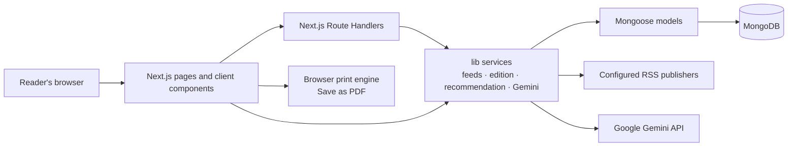
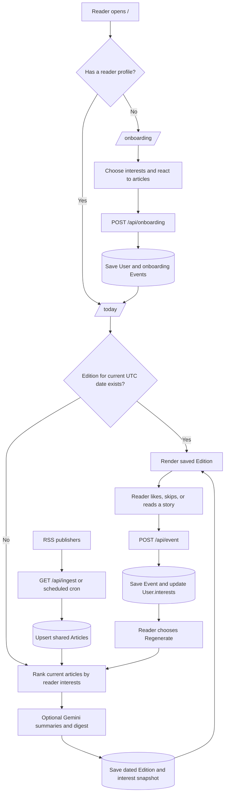
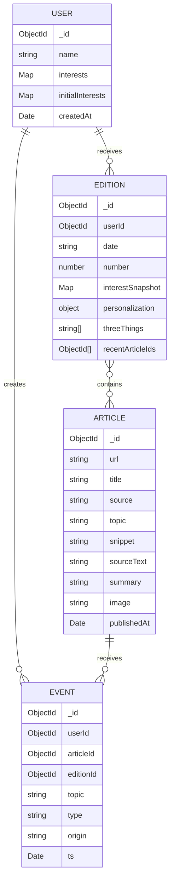
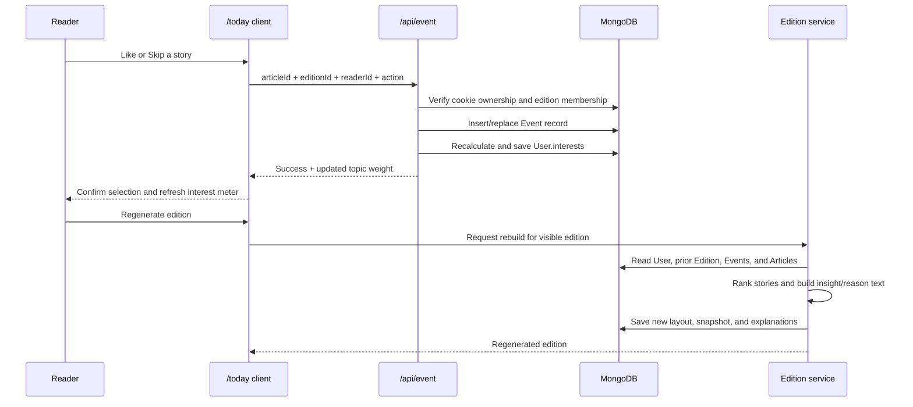

# Echo — Your Daily, Reimagined

Echo is a personalized news newspaper. It collects stories from configured RSS feeds, lets each reader choose topics and give feedback, then builds a dated edition with concise summaries and a small selection of stories outside the reader’s usual interests. Readers can browse saved editions and print a newspaper-style PDF.

This README describes the implementation in this repository. It is not a product roadmap; see [`SKILLS.md`](./SKILLS.md) for the running implementation log and known follow-up work.

## Contents

- [Highlights](#highlights)
- [Architecture](#architecture)
- [Main workflows](#main-workflows)
- [Routes and API](#routes-and-api)
- [Database model](#database-model)
- [Recommendation and learning](#recommendation-and-learning)
- [AI summaries](#ai-summaries)
- [Project layout](#project-layout)
- [Requirements and setup](#requirements-and-setup)
- [Environment variables](#environment-variables)
- [Run and maintain](#run-and-maintain)
- [Deployment](#deployment)
- [Current limitations and operational notes](#current-limitations-and-operational-notes)

## Highlights

- **Personalized onboarding:** readers select topics, then can like or skip sample articles to refine their first edition.
- **Daily newspaper editions:** each reader has one saved edition per UTC date. It is created when the reader visits `/today`, or rebuilt when they choose **Regenerate edition**.
- **RSS ingestion:** articles are fetched from the feed list in [`lib/feeds.ts`](./lib/feeds.ts), deduplicated by canonical feed URL, and stored in MongoDB.
- **Feedback learning:** likes, skips, clicks, and qualified reads are written as events. The reader’s interest weights are recalculated from their onboarding baseline and recent feedback.
- **Discovery:** editions include a “Break the Echo” section. A story rail surfaces recent articles from topics the reader likes.
- **AI-assisted editorial content:** Gemini can generate article summaries and the “Today in 3 Things” digest. Publisher excerpts are used as fallbacks.
- **Archive and print:** saved editions are available at `/archive`; `/print` renders an A4 newspaper layout for the browser’s print dialog.
- **Reader data removal:** the account endpoint deletes the reader’s profile, editions, and feedback events. Shared articles remain available to other readers.

## Architecture

Echo uses the Next.js App Router for pages and HTTP endpoints, Mongoose for MongoDB persistence, RSS feeds as its source pool, and Gemini as an optional editorial service.



### Request and data boundaries

- **Pages** render the public landing page, onboarding, today’s edition, archive, dated editions, and print layout. Server pages read the HTTP-only reader cookies and query the database.
- **Route Handlers** validate incoming requests and mediate writes. In particular, feedback events are associated with the reader profile and, for edition articles, verified against that reader’s saved edition.
- **Library modules** contain feed parsing, edition selection, preference ranking, formatting, database connection management, and Gemini calls.
- **MongoDB** stores reader-private records separately from the shared article pool. Article summaries are stored on shared `Article` records so they can be reused by subsequent editions.
- **External services** are optional at runtime where fallbacks exist: a failed feed is reported without aborting the whole ingestion batch, and a failed or unavailable Gemini response falls back to publisher text.

### Main workflow map



## Main workflows

### 1. Onboarding

1. A new reader visits `/onboarding` and chooses at least three topics.
2. The onboarding client requests candidate articles from `POST /api/onboarding/articles`. Candidate ordering is based on chosen topics, articles already seen, onboarding likes/skips, headline terms, and a per-session rotation seed. Gemini may break a tie among the already-scored candidates; it does not create article candidates.
3. The final onboarding submission goes to `POST /api/onboarding`.
4. The server creates or updates a `User`, initializes topic weights, saves onboarding feedback events, and writes the reader identifier into HTTP-only cookies.
5. The first edition is created when the reader reaches `/today`.

The reader ID is cookie-based; this project does not currently implement email/password authentication or cross-device account recovery.

### 2. Article ingestion

`lib/ingest.ts` fetches each source in [`lib/feeds.ts`](./lib/feeds.ts) concurrently. It limits processing to 25 items per feed, extracts article text and possible image URLs, and records per-feed failures. One broken feed does not stop the others.

Articles are deduplicated by URL. On later ingestions Echo refreshes the publisher excerpt and source text while preserving the saved AI summary. Ingestion only refreshes the shared article pool; it does not pre-create an edition for each reader.

### 3. Edition creation and regeneration

The server chooses stories using the reader’s current topic weights and article freshness. It reduces repeats by excluding recently shown article IDs when enough alternatives exist, removing near-duplicate headlines, and spreading stories across topics and publishers where possible. It saves the edition under the reader and UTC date.

The typical layout contains:

- one lead article;
- up to four secondary articles;
- up to six brief articles;
- up to two discovery articles.

The actual count can be lower when the database has too few eligible articles. The edition stores references to shared articles, its “Today in 3 Things” digest, the interest-weight snapshot used for selection, and per-story explanation strings.

Opening `/today` reuses a valid saved edition for the current UTC date. **Regenerate edition** explicitly rebuilds the current dated edition using the latest saved feedback and sends the edition ID to the server so regeneration targets the reader whose edition is on screen.

### 4. Feedback and personalization

The browser sends Like, Skip, click, and qualified-read actions to `POST /api/event`. The API validates reader cookies, verifies edition membership for newspaper stories, stores the event, and recalculates `User.interests` from the onboarding baseline and recent feedback. Likes and skips replace one another for the same article and edition.

The button state is loaded from saved events when the edition is rendered again. A failed save does not leave the button looking selected; the page displays the API error. The “What Echo learned from you” panel compares saved interest snapshots and is refreshed when an edition is regenerated.

### 5. Archive and PDF

Each edition remains in MongoDB under its date; old editions are not physically moved. `/archive` lists them and `/edition/[date]` renders a selected saved edition. `/print` renders the current edition with a newspaper masthead, lead story, columns, and A4 print rules. The PDF is created by the browser: use **Download PDF**, then select **Save as PDF** in the print dialog.

## Routes and API

### Pages

| Path | Purpose |
| --- | --- |
| `/` | Public Echo landing page |
| `/onboarding` | Reader setup; returns existing readers to their edition when their saved profile is recognized |
| `/today` | Current UTC-date edition and recent-story rail |
| `/archive` | Reader’s saved editions |
| `/edition/[date]` | A saved edition for a specific date |
| `/print` | Print-optimized layout for the current edition |

### Route Handlers

| Method and path | Purpose |
| --- | --- |
| `POST /api/onboarding/articles` | Return the next onboarding article candidate |
| `POST /api/onboarding` | Create or update a reader profile and save onboarding feedback |
| `POST /api/event` | Save a Like, Skip, click, or qualified-read event and update learned interests |
| `GET /api/stories?readerId=…` | Return recent stories and their saved story-rail feedback for the selected reader |
| `POST /api/edition/regenerate` | Rebuild the current edition after validating its ID against the reader cookies |
| `GET /api/ingest` | Manually fetch RSS feeds and upsert articles; currently has no authentication guard, so restrict its exposure before production use |
| `GET /api/cron/ingest` | Scheduled ingestion endpoint; requires `Authorization: Bearer <CRON_SECRET>` |
| `DELETE /api/account` | Delete the cookie-linked profile, editions, events, and reader cookies |

## Database model

The model definitions are in [`model/index.ts`](./model/index.ts). [`models/index.ts`](./models/index.ts) is a compatibility re-export used by a few existing modules.



### Collections

- **User:** reader name, current learned interest weights, onboarding baseline, and creation timestamp.
- **Article:** shared publisher story and optional saved AI summary. Article URLs are unique.
- **Edition:** one edition per reader per date, article references, digest, recent-story IDs, interest snapshot, and personalization explanations. A unique compound index enforces the reader/date key.
- **Event:** raw feedback history. Event types are `click`, `like`, `skip`, and `read`; `origin` distinguishes onboarding feedback from later behavior.
- **LlmCache:** a cache schema is declared, but it is not currently used by the Gemini integration. See [AI summaries](#ai-summaries).

## Recommendation and learning

The current scoring and preference rules are implemented in [`lib/recommendation.ts`](./lib/recommendation.ts) and [`lib/edition.ts`](./lib/edition.ts).

### Interest weights

- Onboarding initializes selected topics to `0.7` and unselected topics to `0.2`.
- Onboarding article likes can add a small initial preference boost, capped at `1.0`.
- Later feedback is rebuilt from the onboarding baseline using recency decay. The current signal values are: click `+0.015`, qualified read `+0.07`, like `+0.18`, and skip `−0.14`.
- Feedback older than 180 days is ignored by the learning calculation. Signals use a 45-day half-life.
- A read is recorded only after the reader has been away from Echo for at least 30 seconds and then returns (within the allowed read window).
- Weights are bounded from `0` to `1`.

These values are configuration in code, not sample reader data.

### Article ranking

Candidate stories are ranked using topic weight, freshness, and a small presentation bonus for available images and excerpts:

```text
score = topic weight
      + freshness × 0.12
      + 0.025 if an image exists
      + 0.015 if a publisher excerpt exists
```

The preferred topic set includes topics above `0.25`; if none pass that threshold, Echo falls back to the reader’s three highest weights. Discovery uses lower-weight topics and stays separate from the preferred-story pool when candidates allow. Echo also filters near-duplicate headlines and tries to vary topics and publishers within the edition.

### Feedback-to-edition sequence



## AI summaries

Gemini requests are made by [`lib/gemini.ts`](./lib/gemini.ts). The configured default model string is `gemini-3.8-flash`; the API key is read from `GEMINI_API_KEY` or `GOOGLE_API_KEY`.

For edition content, Echo sends the selected headlines and available publisher context to Gemini and requests JSON containing one short summary per article plus three digest points. The prompt instructs the model to treat publisher content as untrusted and avoid unsupported claims. Summaries are saved to the shared `Article.summary` field when the article does not already have one. The digest is saved on the `Edition`.

If the API key is missing, a request times out, Gemini returns an error such as HTTP 429, or the output cannot be parsed, Echo falls back to the saved publisher excerpt/source text and deterministic digest text where available.

**Caching status:** the `LlmCache` Mongoose model exists, but `generateWithGemini` does not read or write it. Article summaries are cached on `Article` records after successful generation, so those summary strings can be reused. Gemini calls for a new edition’s digest are not currently cached in `LlmCache` and may be repeated on regeneration.

## Project layout

```text
app/
  api/                         Route Handlers
    account/                   Delete reader data
    cron/ingest/                Protected scheduled RSS ingestion
    edition/regenerate/         Rebuild current edition
    event/                      Persist reader feedback
    ingest/                     Manual RSS ingestion
    onboarding/                 Onboarding APIs
    stories/                    Personalized recent story rail
  archive/                      Edition archive page
  edition/[date]/               Dated edition page
  onboarding/                   Onboarding route and client form
  print/                        Print page
  today/                        Current edition page
  EditionClientView.tsx         Interactive edition UI
  NewsStoryRail.tsx             Recent story viewer
  PrintEditionView.tsx           Newspaper print layout
  page.tsx                      Public landing page
  layout.tsx                    Root metadata, fonts, and layout
lib/
  curate-onboarding.ts          Onboarding article selection
  edition.ts                    Edition generation, summary, archive helpers
  edition-page-data.ts          Database-to-page data mapping
  feeds.ts                      RSS source definitions
  format.ts                     Interest and display helpers
  gemini.ts                     Gemini API client
  ingest.ts                     RSS parsing and persistence
  mongo.ts                      Cached Mongoose connection
  reader-cookies.ts             Reader cookie validation/fallback
  recommendation.ts             Feedback learning and ranking helpers
model/index.ts                  Mongoose schemas and models
models/index.ts                 Compatibility re-export
public/                         Static brand and image assets
vercel.json                     Scheduled ingestion declaration
SKILLS.md                       Implementation log and known follow-up work
```

## Requirements and setup

You need a supported Node.js LTS version, npm, a MongoDB database, and (if you want AI summaries) a Gemini API key.

1. Install dependencies:

   ```bash
   npm install
   ```

2. Create `.env.local` in the project root and set the variables listed below. Keep credentials private; `.env*` files are ignored by Git.

3. Start the development server:

   ```bash
   npm run dev
   ```

4. Open [http://localhost:3000](http://localhost:3000). For an initial local database, fetch the configured RSS articles from `http://localhost:3000/api/ingest`, then go through `/onboarding` and open `/today`.

## Environment variables

| Variable | Required | Purpose |
| --- | --- | --- |
| `MONGODB_URI` | Yes | MongoDB connection string |
| `GEMINI_API_KEY` | For Gemini | Google Gemini API key; preferred key variable |
| `GOOGLE_API_KEY` | Alternative | Used if `GEMINI_API_KEY` is not set |
| `CRON_SECRET` | For scheduled ingestion | Bearer token checked by `/api/cron/ingest` |
| `NEXT_PUBLIC_SITE_URL` | Recommended for deployment | Public origin used to build absolute social metadata URLs |

Example local configuration (replace values locally; never commit real secrets):

```dotenv
MONGODB_URI=mongodb://127.0.0.1:27017/echo
GEMINI_API_KEY=your_gemini_api_key
CRON_SECRET=your_long_random_cron_secret
NEXT_PUBLIC_SITE_URL=http://localhost:3000
```

`CRON_SECRET` and `NEXT_PUBLIC_SITE_URL` are only needed for their corresponding deployment behavior. Gemini summaries can fall back to publisher content if no API key is configured.

## Run and maintain

### Available scripts

| Command | Purpose |
| --- | --- |
| `npm run dev` | Start Next.js development mode |
| `npm run lint` | Run ESLint |
| `npm run build` | Create a production build |
| `npm start` | Run the production server after building |
| `npx tsc --noEmit` | Type-check the TypeScript project |

There is currently no `npm test` script in `package.json`.

### Article refresh schedule

[`vercel.json`](./vercel.json) schedules `GET /api/cron/ingest` every day at **01:00 UTC**. The endpoint requires the configured bearer secret. This scheduled job refreshes the shared RSS article database only; a reader’s edition is created or regenerated when that reader visits `/today` or explicitly regenerates it.

During local development, `GET /api/ingest` manually runs the same ingestion function. This endpoint currently has no authentication guard and should not be exposed as an unrestricted production operation.

### Print to PDF

Open `/print` or use **Download PDF** from today’s edition. In the browser print dialog, choose **Save as PDF**. The site uses print CSS and the browser’s print engine; it does not generate a PDF file on the server.

## Deployment

1. Deploy the Next.js application to a host that supports the project’s Next.js version and App Router features.
2. Configure `MONGODB_URI` and (optionally) `GEMINI_API_KEY` in the deployment environment.
3. Set `NEXT_PUBLIC_SITE_URL` to the exact public site origin for Open Graph/social image metadata.
4. Set a strong `CRON_SECRET` and confirm the deployment host honors the Vercel cron declaration in [`vercel.json`](./vercel.json).
5. Protect or disable `GET /api/ingest` before exposing the deployment publicly.
6. Run `npm run build` as part of deployment and check the host logs for database, RSS, or Gemini failures.

## Current limitations and operational notes

- **Cookie-based identity:** reader profiles are identified by long-lived browser cookies. There is no account login, password recovery, or cross-device sync. Clearing cookies can make an existing profile inaccessible from that browser.
- **Shared article content:** articles and their saved summaries are shared across readers. Deleting a reader removes their private profile, editions, and events, but leaves shared articles intact.
- **Gemini limits:** Gemini can fail or return rate limits. AI output is optional; publisher text and deterministic fallback summaries keep an edition renderable. `LlmCache` is not integrated yet.
- **Publisher variation:** feeds may change, go offline, or omit complete text or images. Ingestion records feed failures; the UI can fall back when images are unavailable.
- **Daily edition generation:** cron does not build a separate edition for every reader. A new UTC-date edition is generated on the reader’s first `/today` visit for that date.
- **Manual ingestion endpoint:** `/api/ingest` is currently unauthenticated. Restrict access or add an authorization check before production use.
- **Verification:** run lint/type checking/build locally and visually verify the browser print preview and reader flows against a configured MongoDB instance. Automated integration tests are not currently defined.

## License

No license file is currently included in this repository. Add one before redistributing the project if you intend to publish it as open source.
